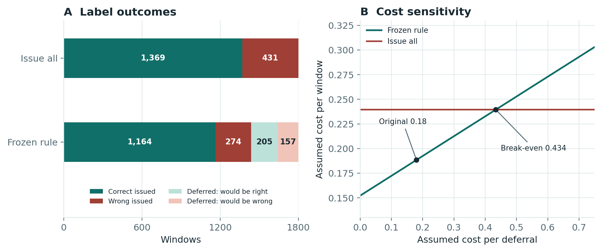

# Sensor Event Detection Under Channel Dropout

**An independent applied machine learning project by James Jean.** When one of two synchronized monitoring channels goes missing, should an equipment team issue an automated event label or send the window to review? I built a reproducible CPU benchmark to compare that decision across three dropout conditions.

**Recommendation:** Take the frozen confidence rule into shadow evaluation. Measure missed events and review capacity before it changes live decisions.

[Technical manuscript (PDF)](manuscript/Technical_Manuscript.pdf) · [Decision memo (PDF)](memo/Decision_Memo.pdf) · [Editable memo (DOCX)](memo/Decision_Memo.docx) · [LaTeX build](manuscript/BUILD.md)

| Held-out comparison under sustained dropout | Result |
| --- | ---: |
| Average precision: CNN vs. fixed-feature logistic regression | **0.517 vs. 0.352** |
| Paired average precision difference | **+0.166** (95% device-bootstrap interval 0.116–0.205) |
| CNN coverage with the frozen deferral rule | **1,438 / 1,800** (79.9%) |
| Error among issued labels vs. issuing every label | **274 / 1,438** (19.1%) vs. **431 / 1,800** (23.9%) |
| Deferred model labels, had they been issued | **157 wrong**, **205 correct** |

The CNN ranked events above both baselines in all three conditions. Its average precision still fell from 0.798 when clean to 0.517 under sustained loss. The frozen rule reduced wrong automated labels but kept 260 false negatives under sustained loss. A shadow evaluation should adjudicate both issued and deferred windows; reviewing only the queue would miss confidently wrong automated labels.

**Post-hoc decision analysis:** The fixed rule would defer 201 items per 1,000 windows under the observed sustained-dropout mix. In the simplified loss (one unit per wrong automated label), costs are 0.188 vs. 0.239 per window at the original 0.18-unit deferral cost. The policies break even at 157/362, about 0.434 units per deferral. These are not dollars, forecasts per hour, or estimates of reviewer accuracy. No cutoff was changed.

The controlled generator supplies the signals and known labels. The same 1,800 held-out windows from 30 unseen device instances appear in every condition. Training, probability calibration, policy choice, and test use disjoint devices in chronological blocks. This project does not establish physical-device performance, human review outcomes, or financial return.

## Read and reproduce

| Location | What it contains |
| --- | --- |
| [benchmark/](benchmark/) | Frozen simulator, models, validation, metrics, tests, and environment pins |
| [evidence/](evidence/) | Original predictions, metrics, split and decision records, audit outputs, and verification summary |
| [analysis/](analysis/) | New fixed-policy description, input hashes, and figure code |
| [manuscript/](manuscript/) | Technical PDF, LaTeX, bibliography, and figure assets |
| [memo/](memo/) | Two-page decision memo in PDF and DOCX, plus its builder |
| [EXPERIENCE.md](EXPERIENCE.md) | Project language supported by the evidence |

Verify the saved scores and describe the fixed policy from the repository root with Python 3.10 or newer. These commands use the standard library and do not train models:

~~~sh
python benchmark/verify_results.py evidence
python analysis/describe_fixed_policy.py
~~~

For the full CPU benchmark, use Python 3.10.11 and the pinned packages. The two original runs used Windows x86-64 with CPU PyTorch. Exact byte comparison includes the recorded environment; results on different platforms may differ at floating-point precision. The runner checks the unmodified Model Evidence 0.7.0 wheel in `benchmark/vendor/` (SHA-256 `05cc0ea20a4bc907d74dd67722880c5d9ab23966216a8466182053dd0ad97ed3`). The wheel is included only to reproduce the original audit pipeline, with its MIT notice.

~~~sh
python -m pip install -r benchmark/requirements.txt --extra-index-url https://download.pytorch.org/whl/cpu
python -m unittest discover -s benchmark -p test_benchmark.py -v
python benchmark/run.py --out rerun
python benchmark/verify_results.py evidence --compare rerun
python analysis/make_figures.py
~~~

Use a fresh output directory for each run. Historical checks: **10 tests passed**; a fresh CPU process reproduced eleven core files and nine dependency audit reports. There were **three seeded CNN fits plus one separate label-shuffle control** and **16,200 scored rows**. The shuffle gave 0.3643 average precision versus 0.2717 test prevalence. It does not define a null distribution or rule out leakage. The independent saved-score verifier checks point metrics and contrasts; the original bootstrap endpoints were reproduced.

See the [file manifest](SHA256SUMS.txt) and the [Model Evidence MIT notice](benchmark/vendor/MODEL_EVIDENCE_LICENSE.txt).
